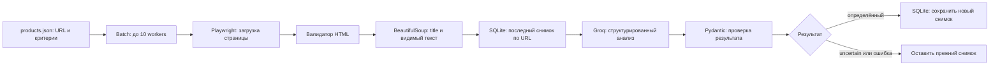

# Design doc: Мониторинг конкурентов: цены и условия

Основан на шаблоне команды [Reliable ML](https://github.com/IrinaGoloshchapova/ml_system_design_doc_ru/blob/main/ML_System_Design_Doc_Template.md) и на [design doc курса «Современные методы NLP»](https://github.com/xufana/modern_nlp_llm/blob/main/hw/hw_01.md); порядок разделов перестроен под методику этого курса: контракт → бюджеты → eval → baseline → усложнения.

| | |
|---|---|
| Авторы | Боженов Ростислав, Трондин Артем, БПМИ244 |
| Версия | 0.6 |
| Статус | черновик |
| Обновлён | 22.11.2026 |
| ADR | [ADR-001: фиксированный pipeline](../docs/adr/ADR-001-fixed-pipeline.md) |

---

## 1. Контекст проекта

### 1.1 Бизнес-задача

- **Проблема.** Аналитики вручную обходят сайты конкурентов для отслеживания изменений(до 200 страниц в день). При средней скорости на страницу 1-2 минуты это 3-7 часов. При стоимости часа аналитика 500 рублей - это 1500-3500 рублей в день. 
- **Почему без LLM-системы не справиться.** Сайты конкурентов скорее всего имеют различную структуру, а так же могут меняться со временем. Это значит, что без LLM необходимо для каждого из сайтов писать свой парсер и с какой-то частотой его обновлять(в случае автоматизации мониторинга). В случае использования LLM для извлечения нужных данных с сайта появляется возможность добавлять новые страницы товаров в список мониторинга без необходимости писать новый парсер, а так же делает систему устойчивой к внешним изменениям. Так же некоторые параметры товаров, например акции, без LLM мониторить не получится. 
- **Почему именно это решение имеет смысл.** Парсинг сайтов строго привязан к их структуре. Использование LLM для извлечения данных позволяет убрать эту зависимость, делает систему устойчивой к внешним измененниям. Автоматизация же в целом экономит время и позволяет быстрее реагировать на изменения.
- **Критерии успеха с точки зрения бизнеса.** Время обработки изменений сокращается с 5 часов при ручном просмотре до 1 часа. Количество найденых страниц с значимыми(определение значимости будет ниже) изменениями не меньше 90 процентов. Среди указанных как значимые изменений не меньше 80 процентов действительно значимые.


### 1.2 Пользователи и сценарии использования

- **Кто.** Аналитики(1-2 человека для небольшой кампании) анализируют полученные сигналы и передают требующие реакции кейсы дальше.   
- **Через что.** В чат в вебе автоматически приходит ежедневный отчет.
- **Нагрузка.** 10-20 конкурентов по 5-10 товарам. Получается ежедневный обход с анализом максимум 200 страниц. Пиковая нагрузка - обход утром. 
- **Цена ошибки.** В случае ложного сигнала аналитику придется потратить лишнее время на разбор незначительного кейса. Если важный кейс будет проинтерпретирован как неважный, то он не получит требуемой реакции -> потенциальные убытки. Из этого следует recall важнее, чем precision.
- **Что для пользователя «хорошо».** Аналитик напрямую сэкономит время на анализ изменений. Категорийные менеджеры будут раньше и быстрее получать требуемую информацию -> меньше задержка перед реакцией -> меньше убытки от последствий действий конкурентов. 

*Где и с кем мы общаемся — определяет и вход, и выход: язык, тон, длину, что можно показывать.*

### 1.3 Границы, ограничения и допущения

**Границы системы.** Что внутри нашей ответственности, а что снаружи. За то, что снаружи, гарантий не даём.

| Внутри (наш код, наши данные) | Снаружи (провайдер, внешний API, чужой сервис) |
|---|---|
| получение данных со страниц конкурентов | содержится ли необходимая информация на страницах |

| Промпт извлечения и структурирование информации | Провайдер LLM со всеми условиями и возможностями |

| Валидация полученных значений | Доступность API |

| Сравнение с предыдущим снапшотом | получение страниц товаров конкурентов(сами ссылки дает пользователь) | 

| Применение фильтров значимости | фильтры значимости(заказчик указывает, какое изменение цены или параметров товара считать значимым) |

| Формирование отчёта | параметры, не входящие в список мониторящихся(указан ниже, в контракте), например, регион продажи товара |

| Хранение истории изменений и снапшотов |  |


**Что явно не делаем.**

-не ищем нужные ссылки на страницы товаров

-не подбираем критерии значимости(их выбирает заказчик)


**Допущения**, которые ещё не проверены: 
о данных: 

-список отслеживаемых страниц конкурентов стабилен

*об инфраструктуре*: 

-сайты конкурентов не блокируют запросы для получения HTML

*о безопасности и нормативах*: 

-информация с сайтов конкурентов в открытом доступе и не нарушает их политику конфиденциальности

*о поведении пользователей*: 

-менеджер читает только отчёт, имеющий высокую точность.

*Отвечаем ли на вопросы не по предметной области? Какие репутационные риски, если ответим?*

-Мы не отвечаем на вопросы, а только генерируем отчёт о конкурентах

---

## 2. Контракт сервиса

Контракт — это то, что мы будем измерять. Каждый пункт превращается в метрику или тест в разделе 5. Если пункт нельзя измерить, это не контракт, а пожелание.

### 2.1 Контракт

| Поле | Что обещаем | Как проверим (ссылка на метрику из 5.2) |
|---|---|---|
| **Вход** | список url требуемых к мониторингу страниц товаров конкурентов и какой товар на них мониторить (например, молоко Простоквашино 3,2% 1л по региону Казань), критерии значимости изменения, основывающиеся на мониторящихся параметрах (например изменение цены на 100 рублей/на 5 процентов, изменения условий акций, изменение условий или стоимости доставки товара и тд)| валидация url |
| **Выход** | список url для которых отмечены значащие изменения, с указанием этих изменений | precision, recall по нахождению значащих изменений и по верности извлечения изменений |
| **Поведение при неуверенности** | отправляем отдельным сообщением ссылки, для которых результат не определен (не получилось извлечь данные, не открывается ссылка и тп)| в зависимости от причины(внешняя - внутренняя) либо не учитываем кейс в метриках из прошлого пункта(precision, recall), либо учитываем как неверно извлеченные |
| **Чего не обещаем** | что будут найдены все важные изменения, что не будут даны ложные сигналы | ограничения зафиксирорваны в документации |
| **Нефункциональные** | задержка(длительность выполнения) | длительность выполнения |

**Контракт одной фразой** (пример из курса: «На вопрос на русском возвращает ответ, опирающийся на ≥1 фрагмент документации, со ссылкой на источник; если фрагментов нет — говорит об этом явно; первый токен ≤ 1,5 с, полный ответ ≤ 10 с; вне базы не отвечает»):

> Раз в день обходим заданный список страниц товаров конкурентов, внешняя программа получает html страницы и передает его вместе с предыдущим снапшотом(значение мониторящихся параметров), описанием товара для мониторинга и критериями значимости изменений модели, модель извлекает из html цену товара, условия(наличие) акций, цену и условия доставки, наличие товаров, условия оплаты, условия гарантии, сравнивает параметры с предыдущим снапшотом, и по критериям значимости классифицирует кейс как значимый/незначимый и передает результат назад внешней программе. После обхода всех страниц формируется список значимых изменений, список несработавших кейсов(не получилось извлечь данные, не получилось получить сайт и тп)(списки формируются внешней программой) и отправляются пользователю.

### 2.2 Сценарии взаимодействия

**Основные сценарии.** Для каждого: что говорит пользователь, что делает система, чем заканчивается.

| Сценарий | Пример | Что делает система | Результат для пользователя |
|---|---|---|---|
| значимое изменение цены | цена продукта с 1299 рублей упала до 1199 рублей | извлекает цену, сравнивает с предыдущим снапшотом и делает вывод о значимости | строка в отчете 1299 -> 1199 рублей |
| незначительное изменение цены | цена продукта с 1299 рублей упала до 1298 рублей | извлекает цену, сравнивает с предыдущим снапшотом и делает вывод о значимости | не показывается в отчёте |
| изменение в структуре сайта | добавлена плашка тех. Поддержки на сайте конкурента | парсит изменение и не находит в нём информации о цене | не показывается в отчёте |
| изменение наличия товаров | в начилии -> нет в наличии | парсит изменение и добавляет в отчёт | строка в отчётё товар на сайте Х отсутствует |
| изменение условий | цена доставки выросла на 2000 рублей | парсит изменение и добавляет в отчёт | строка в отчёте условие ... на сайте Х |


**Исключительные сценарии.** Это половина контракта: продумайте, где можем ошибиться и как это обработано.

| Ситуация | Поведение системы | Что видит пользователь |
|---|---|---|
| страница недоступна | 2-3 попытки перезагрузки, затем пометка о проблеме | сайт конкурента недоступен |
| товар не найден | пометка об отсутствии данных | данные о товаре на сайте конкурента отсутствуют |
| anti-bot заглушка | 2-3 попытки перезагрузки, затем пометка о проблеме | сайт конкурента недоступен |
| модель вернула невалидный формат или зациклилась | повторный вызов с тем же промптом, максимум 2 попытки, затем пометка | ошибка формата вывода |

### 2.3 Диалоговая логика и тон

У нас не диалоговая система. Запрос выполняется раз в день автоматически.
---

---

## 3. Три бюджета и SLO

Бюджеты фиксируются до выбора архитектуры и становятся ограничением. Дальше архитектура подбирается под них, а не наоборот. Если кажется, что ограничений нет, поищите получше.

### 3.1 Качество

Качество ≠ «модель умнее». Качество = система выполняет контракт на нашем распределении запросов.

| Метрика (из контракта) | Как считаем | Целевое значение | Ниже чего — откат |
|---|---|---|---|
| precision верности нахождения изменений | считаем по выводу модели, сравнивая с правильным набором измененных значений(верно указано новое значение цены и тп) | >80% | <75% |
| recall верности нахождения изменений | считаем по выводу модели, сравнивая с правильным набором измененных значений(верно указано новое значение цены и тп)| >80% | <75% |
| precision классификации изменений на значимые/не значимые | считаем по выводу модели, сравнивая с правильным набором товаров с значимыми изменениями | >80% | <75% |
| recall классификации изменений на значимые/не значимые | считаем по выводу модели, сравнивая с правильным набором товаров с значимыми изменениями | >90% | <85% |


### 3.2 Задержка

| Этап | Оценка, мс | Откуда число |
|---|---|---|
| сеть + шлюз | 50-200мс | по занятию |
| инструменты | - | не используются |
| × число запросов к LLM модели | 1 на страницу | извлечнение параметров товара и проверка на значимость |
| **Итого на страницу** | <1 минуты | запрос на получение html + извлечение и анализ даных моделью |
| **Итого e2e на обход 200 страниц (последовательно)** | <3 часов | кол-во страниц х время на страницу |
| **Итого e2e на обход 200 страниц (10 воркеров)** | <20 мин |
|


Целевые значения: итоговое время работы дневного запроса < 4 часов. Время для нас не сильно критично, поскольку запрос выполняется автоматически раз в день, и может быть выполнен ночью, то есть к моменту, когда аналитик придет на работу, результаты будут готовы.

### 3.3 Стоимость

```
cost_per_request ≈ tokens_in × price_in + tokens_out × price_out (+
retrieval + инструменты)

cost_per_month = cost_per_request × requests_per_month

```

| Параметр | Значение | Откуда |

|---|---|---|

| tokens_in на страницу (системный промпт + html + предыдущий снапшот) | ~30000
| html - самое тяжелое  |

| tokens_out на страницу | ~1500 | JSON с извлечёнными данными(без ссылок) |

| вызовов модели на страницу | 1 | извлечение параметров + определение знаимости |

| requests_per_month | 6000 | 200 страниц/день × 30 дней |

| **cost_per_request(на страницу)** | ~$0.05--0.1 | зависит от модели |

| **cost_per_month** | ~$300-600| 6000 × cost_per_request |

Скрытая стоимость: Хранение снапшотов - малый объем(пару мегабайт), поэтому дешево.

Если self-host: Не планируем, так как объем запросов достаточно мал.

### 3.4 Компромисс

Главный бюджет — качество, а не стоимость и не задержка. Объём запросов достаточно маленький (200 страниц/день), стоимость тоже маленькая(относительно работы аналитика). Задержка не сильно критична, поскольку работа автоматическая и запускаться может ночью/ранним утром. Поэтому можем позволить более дорогую модель, если это снижает ложные сигналы. Жертвуем: скоростью обхода (до 4 часов) и стоимостью (до 600 долларов/мес) ради качества.

### 3.5 SLI и SLO

| SLI | Как считаем | SLO | Error budget |
|---|---|---|---|
| Своевременность отчёта | доля дней, когда отчёт готов до 09:00 | ≥ 99 % | 1 % дней (~0.3 дня за 28) |
| Полнота обхода | доля страниц из списка, по которым сохранён снапшот | ≥ 98 % | 2 % страниц |
| Precision по тревогам | judge на выборке ~200 строк/неделю, сверенный с человеком на ~50 примерах | ≥ 90 % | 5 % строк |
| Recall по значимым изменениям | доля реальных изменений из canary-набора ~50 пар снапшотов, попавших в отчёт | ≥ 80 % | 10 % изменений |
| Точность извлечения цены | доля страниц, где цена подтверждена, среди страниц, где цена есть | ≥ 99 % | 1 % страниц |
| Доля пометок «требует ручной проверки» | доля страниц, где извлечение не удалось или значение вне диапазона | ≤ 5 % | 5 % страниц |
| Доступность пайплайна | доля запусков, завершившихся формированием отчёта (пусть частичного) | ≥ 99 % | 1 % дней (~0.3 дня за 28) |
| Ошибки валидации формата | доля вызовов модели с невалидным JSON после ~2 ретраев | ≤ 1 % | 1 % |
| Стоимость прогона | суммарная стоимость LLM-вызовов за день | ≤ $20 в день (лимит $600/мес из расчёта KT2) | — |
| Время аналитика на разбор отчёта | самооценка аналитика, минут в день | ≤ ~20 мин | — |

**Сбор фидбека.** Прототип формирует JSON-отчёт в runs/. Интерфейс для отметок аналитика и доставка по email/Telegram не реализованы. Ручная проверка выполняется вне приложения; согласованные ошибки можно добавить в eval-набор.
---

---

## 4. Архитектура решения

### 4.1 Схема по семи блокам



| Блок | Реализация в проекте | Граница |
|---|---|---|
| Клиент | products.json и CLI-запуск | Веб-интерфейс и чат-уведомления не реализованы |
| Шлюз | Прямой Groq API через OpenAI-compatible client | Отдельного API gateway нет |
| Оркестратор | Фиксированный Python pipeline | Агентного цикла нет |
| Инференс | Groq, openai/gpt-oss-120b, temperature 0 | Доступность и TPM определяет провайдер |
| Хранилище | SQLite: последний успешный снимок по URL | Архив старых снимков не ведётся |
| Инструменты | Playwright Chromium, BeautifulSoup, Pydantic | Загружаются переданные URL |
| Наблюдаемость | JSON-отчёт harness | Production tracing запланирован в KT4 |

### 4.2 Путь одного запроса

1. Batch читает URL, описание товара и критерии значимости из products.json; до 10 URL обрабатываются параллельно, порядок результатов сохраняется.
2. Playwright ждёт domcontentloaded до 30 секунд и ещё 2 секунды для рендеринга. HTTP >=400, пустая страница, антибот-ответ или недостаток видимого текста дают ошибку URL.
3. Парсер удаляет script/style/noscript/svg, извлекает заголовок и видимый текст. Текст свыше 100 000 символов отклоняется до вызова модели.
4. Из SQLite читается последний снимок по URL. В запрос передаются URL, описание товара, критерии, заголовок, текст страницы и предыдущий снимок.
5. Groq возвращает JSON; Pydantic проверяет схему. Новый снимок сохраняется только при определённом результате; при uncertain или ошибке старый снимок остаётся.

### 4.3 Данные и база знаний

Отдельной базы знаний, retrieval и индекса нет. Источник данных — публичная HTML-страница товара по URL из products.json; структурированное состояние — последний снимок в SQLite. Eval использует замороженные HTML-фикстуры и не обращается к сайтам. Сырые HTML-страницы в production SQLite не сохраняются.

### 4.4 Модель и промпты

- **Модель:** openai/gpt-oss-120b через Groq API.
- **Промпт:** src/extraction/prompts.py; user prompt содержит URL, критерии, текст страницы и предыдущий snapshot. Хеш промпта сохраняется в eval-отчёте.
- **Формат:** JSON object с последующей проверкой Pydantic; temperature=0, max_tokens=4096.
- **Контекст:** видимый текст ограничен 100 000 символами; это эвристика, а не точный токенизатор.
- **Повторы:** до 3 попыток для временных ошибок и формата; repair retry получает сообщение Pydantic о нарушении схемы.
- **Дообучение:** не планируется.

### 4.5 Интеграции и интерфейсы

| Интеграция | Назначение | Способ |
|---|---|---|
| Groq API | Анализ текста страницы | OpenAI-compatible HTTPS API |
| SQLite | Последний снимок товара | Локальная БД |
| Сайты конкурентов | Получение HTML | Playwright Chromium |

Пользовательский чат, CRM-интеграция и веб-интерфейс не реализованы; запуск выполняется из CLI, результат формируется в отчёт.

### 4.6 Инфраструктура и развёртывание

Локальный Python-процесс, Playwright Chromium и SQLite; inference выполняется во внешнем Groq API. Отдельных production-сред, GPU, fallback-провайдера и production-развёртывания нет: это учебный прототип.

---

## 5. Харнесс и инструменты

### 5.1 Инструменты и скиллы

| Компонент | Контракт и лимит | Поведение при ошибке |
|---|---|---|
| Fetcher Playwright | URL → HTML; navigation до 30 с + 2 с рендера | HTTP >=400, timeout, пустая страница — ошибка URL; fetch retry нет |
| Валидатор/парсер | HTML → заголовок и видимый текст; максимум 100 000 символов | Короткая/пустая/anti-bot страница отклоняется до модели; снимок не меняется |
| SQLite | URL → последний снимок; определённый снимок → запись | Ошибка изолируется на URL |
| GroqClient | AnalysisRequest → AnalysisResult; timeout 90 с по умолчанию через GROQ_TIMEOUT_SECONDS; до 3 попыток | Повторяет timeout, connection, rate limit и ошибки схемы; после исчерпания — error |
| Batch | Список товаров → упорядоченный отчёт; до 10 workers | Ошибка одного товара не останавливает остальные |

Модель не выбирает и не вызывает инструменты самостоятельно; agent skills и агентный цикл не используются.

### 5.2 Цикл

products.json → загрузка URL → валидация и парсинг HTML → чтение предыдущего снимка → один логический запрос модели с ограниченными retry → Pydantic validation → запись снимка только при определённом результате. В harness fetcher заменён фикстурой, запись в production SQLite отключена.

### 5.3 Многошаговые сценарии

Scripted replay покрывает шесть последовательных случаев: изменение цены; косметическая правка HTML; ошибка fetch между успешными проверками; возврат значения; исчерпание лимита шагов; смена наличия туда-обратно. Все шесть прошли без сети и расходов на API. Это проверка workflow и состояния, но не качества модели. Отчёт: runs/scenario-replay.json.

---

## 6. Память и состояние

Между ежедневными обходами хранится только последний успешный структурированный снимок по URL в SQLite. История старых снимков и диалога модели не передаётся. Сырая HTML-страница существует в памяти во время обработки и не сохраняется в production SQLite. Рабочее состояние batch живёт в памяти процесса. В harness предыдущий снимок задаётся фикстурой, persistence отключён. При ошибке или uncertain предыдущий снимок остаётся без изменений. Кэша, RAG и эпизодической памяти нет.

---

## 7. Eval-план

### 7.1 Eval-сет

Замороженный набор: tests/eval/kt2_original.csv и tests/eval/kt2_frozen.jsonl. В нём 80 строк: 39 significant, 26 noise, 15 error. Это расходится с долями в описании KT2 (40% / 25% / 30%); метки не перебалансированы. Исходник содержит HTML-фрагменты; конвертер создаёт fixtures для baseline и модели. 15 error-страниц остаются невалидными. URL синтетические, live-запросов нет. Производные expected_fields и previous_snapshot нужно выборочно проверить вручную.

### 7.2 Метрики

Считаются change detection precision/recall, significance classification precision/recall, accuracy статуса и exact match извлечённых полей. Также сохраняются вызовы/повторы, токены, длительность и стоимость, если заданы тарифы. Цели KT2: change P/R >80%; significance precision >80%, recall >90%.

### 7.3 Процедура

Baseline-only: python -m src.evaluation.harness tests/eval/kt2_frozen.jsonl --baseline-only --label kt2-baseline. Полный запуск сравнения: python -m src.evaluation.harness tests/eval/kt2_frozen.jsonl --label kt2-full-balanced --request-interval-seconds 15. Нужен GROQ_API_KEY; для оценки стоимости также задать GROQ_INPUT_USD_PER_MILLION и GROQ_OUTPUT_USD_PER_MILLION. JSON-отчёт в runs/ содержит eval- и prompt-хеши, модель, настройки и результаты по каждой строке.

### 7.4 Контроль качества в рантайме

HTML и длина текста валидируются до вызова модели. Ответ проверяется Pydantic; пустые строки в changes удаляются, другие schema errors получают ограниченный repair retry. При ошибке и uncertain снимок не обновляется. Семантическая groundedness значений по HTML автоматически не проверяется.

---

## 8. Baseline и план усложнений

### 8.1 Baseline

KT2 baseline — посимвольный HTML diff. На 80 строках: change detection P=0.5625 (45 TP, 35 FP), R=1.0 (45 TP, 0 FN); significance P=0.4875 (39 TP, 41 FP), R=1.0. Ложные срабатывания — косметические изменения и ошибки страниц. Отчёт: runs/20261121T081602Z-kt2-baseline-corrected.json.

### 8.2 Усложнения

Текущая система: Playwright → парсер текста → Groq → Pydantic → SQLite.

| Прогон | Change P/R | Significance P/R | Status accuracy | Exact fields |
|---|---:|---:|---:|---:|
| KT2 baseline | 56.3% / 100% | 48.8% / 100% | 48.8% | неприменимо |
| KT3, runs/20261122T101925Z-kt2-full.json | 95.3% / 91.1% | 96.9% / 79.5% | 88.8% | 85.0% |
| KT3 prompt iteration, runs/20261122T104549Z-kt2-full-fixed.json | 95.1% / 86.7% | 100% / 64.1% | 82.5% | 83.8% |
| KT3 balanced prompt, runs/20261122T111422Z-kt2-full-balanced.json | 95.1% / 86.7% | 97.1% / 84.6% | 90.0% | 82.5% |

Последний прогон использовал модель openai/gpt-oss-120b, temperature=0, seed=null, eval SHA-256 2f9afe6587b4c1ec6e1d7e60c0b25fdb3cd68e72555934786fc20d158d9e97f4 и prompt SHA-256 4282f8f03d1a2419d4b1a40b858838a901224751c518874c9386d67cb196be83. Из 80 строк 65 валидных страниц были отправлены модели; 15 ожидаемых error fixtures отклонил валидатор. На 65 страницах модели status accuracy=57/65 (87.7%), exact fields=51/65 (78.5%). Было 65 вызовов без retry; длительность 1068.7 с; input tokens=77 118, output tokens=35 104. Общая status accuracy=90% и exact fields=82.5% в отчёте включают 15 ожидаемых ошибок страниц.

Change detection достиг целевых P/R >80%; significance precision достиг целевого >80%, но recall 84.6% ниже целевого >90% (6 FN из 39 значимых изменений). Последний вариант улучшил recall на 20.5 п.п. относительно предыдущей prompt iteration, сохранив precision выше 97%, но целевое качество ещё не достигнуто.

Последний прогон выполнен на бесплатном тарифе Groq. Фактическая стоимость этого прогона не указывается: harness сохранил known_cost_usd=null, а данные о списаниях отсутствуют. Стоимость платного использования будет указана позже, когда появятся фактические данные биллинга.

Интерпретация ограничена eval-набором: 39 significant, 26 noise, 15 error не совпадают с распределением в описании KT2; метки и derived snapshots требуют ручной проверки. Пример 23 размечен как значимое изменение цены, хотя оплачиваемая цена до/после выглядит одинаковой. Schema snapshot не содержит return_conditions и product_status, поэтому эти изменения нельзя надёжно хранить и сравнивать. Полный прогон использует тот же набор, на котором итеративно менялся prompt; это диагностическое сравнение, не независимая holdout-оценка.

---

## 9. Наблюдаемость

Production tracing не внедрён; планируется в KT4. Trace на товар должен включать fetch, parsing, чтение snapshot, попытки LLM, validation и persistence; поля: trace_id, хеш URL, модель и версия промпта, номер попытки, latency, токены, стоимость, статус, тип ошибки, длина текста и решение о записи. Сырой HTML и API-ключ не логируются. Offline harness уже сохраняет eval/prompt hashes, модель, настройки, время, attempts, usage, стоимость при наличии тарифов и построчные результаты.

---

## 10. Риски, ограничения, безопасность

### 10.1 Структурные ограничения модели и чем закрываем

| Ограничение | Что есть сейчас | Остаток |
|---|---|---|
| Неверная структура JSON | Pydantic validation; ограниченный repair retry | JSON mode не гарантирует полное соответствие схеме |
| Выдуманные значения | Промпт требует опираться только на страницу | Семантическая groundedness отдельно не проверяется |
| Неверная значимость | Criteria передаются модели; prompt содержит порядок сравнения | Recall последнего прогона 84.6%, целевой порог >90% не достигнут |
| Prompt injection из HTML | HTML считается недоверенным в system prompt | Формальной adversarial-проверки нет |
| Отсутствующие поля в snapshot schema | Часть полей не представлена в CompetitorOffer | return_conditions и product_status нельзя надёжно сравнить/сохранить без расширения схемы |

### 10.2 Риски проекта

| Риск | Действие | Статус |
|---|---|---|
| Recall значимости ниже порога | Продолжить балансировать prompt и повторить eval | Открыт |
| Расхождение распределения eval | Сверить 39/26/15 с KT2; сохранить исходные метки до согласования | Открыт |
| Возможная ошибка gold label / derived snapshot | Ручная проверка отмеченных строк, включая пример 23 | Открыт |
| TPM, timeout или формат ответа провайдера | Интервал запросов, timeout 90 с, до 3 попыток | Частично закрыт; зависит от API |
| Используется бесплатный тариф провайдера | Фактическая стоимость платного использования будет внесена после появления данных биллинга | Отложено до платного использования |
| Anti-bot на реальных сайтах | Отдельный live-прогон; harness использует fixtures | Открыт |
| Production tracing отсутствует | Внедрить в KT4 | План |

### 10.3 Безопасность, соответствие, этика

В prompt передаются публичные страницы конкурентов и описание товара. API-ключ читается из окружения и не включается в eval-отчёт. Сырые страницы не сохраняются в production SQLite. Автоматических действий с последствиями нет: результат предназначен для просмотра аналитиком. Юридическая проверка условий сайтов и правил провайдера отдельно не проводилась.

---

## 11. Открытые вопросы

| Вопрос | Владелец | Срок | Статус |
|---|---|---|---|
| Поднять significance recall выше 90%, не потеряв precision, затем повторить eval | Ростислав | До сдачи КТ3 | Открыт; последний результат 84.6% |
| Проверить derived expected_fields/snapshots и спорную разметку примера 23 | Команда | До итогового вывода | Открыт |
| Решить, добавлять ли return_conditions и product_status в snapshot schema | Команда | Следующая редакция | Открыт |
| Указать фактическую стоимость после перехода на платное использование и получения данных биллинга | Ростислав | После появления расходов | Отложено; сейчас используется бесплатный тариф |
| Согласовать фактическое распределение eval-классов | Команда | До защиты | Открыт |
| Проверить выбранные реальные URL и anti-bot обработку | Команда | Следующая итерация | Открыт |
| Production tracing и история переходов | Команда | KT4 | Запланировано |

---

## 12. План работ и эксплуатация

### 12.1 Этапы

| Этап | Результат | Проверка | Статус |
|---|---|---|---|
| KT1 | Контракт, бюджеты, примеры | Документ | Выполнено |
| KT2 | Pipeline и eval-план | Код и design doc | Выполнено |
| KT3: архитектура и сценарии | Компоненты, память, harness, 6 scripted сценариев, ADR | Replay: 6/6 | Выполнено |
| KT3: измерение | Baseline и model eval на 80 строках | Balanced prompt: significance recall 84.6%, ниже цели >90% | Измерено; требование по целевому recall пока не выполнено |
| Перед сдачей | Проверить labels/schema gaps и внести актуальные цифры в doc | §8, §10, §11 и этот план | Документ обновлён; качество модели остаётся открытым |

### 12.2 Поддержка и эксплуатация

Это учебный прототип без production-деплоя и дежурств. Ошибка одного URL изолируется; при неуспехе прежний snapshot сохраняется. Обновление модели или prompt требует повторного eval. Production alerts, canary и tracing не внедрены.

---

## 13. Ресурсы

- **Люди:** ручная проверка разметки выполняется командой.
- **Вычисления и сервисы:** локальный Python/Playwright, SQLite, внешний Groq API; GPU и векторная БД не используются.
- **Затраты:** сейчас используется бесплатный тариф Groq. Фактическую стоимость укажем позже, когда появятся данные о платном использовании.
- **Отдача:** KT2 ожидает сокращение ручного мониторинга; фактическая экономия в рамках прототипа не измерена.

---

## 14. Приложения

- **Термины:** snapshot — последний структурированный снимок; eval — оценка на размеченном наборе; TPM — лимит токенов в минуту.
- **Архитектура и путь запроса:** раздел 4.1–4.2.
- **Eval и prompt:** tests/eval/README.md, tests/eval/kt2_original.csv, tests/eval/kt2_frozen.jsonl, src/extraction/prompts.py.
- **Harness и сценарии:** src/evaluation/harness.py, src/evaluation/scenario_harness.py.
- **ADR:** docs/adr/ADR-001-fixed-pipeline.md (принято).
- **Mockups:** не применимо, пользовательский интерфейс в прототипе отсутствует.

---

## История изменений

| Дата | Версия | Что изменилось | Почему |
|---|---|---|---|
| 29.09.2026 | 0.1 | Контракт, бюджеты, 20 примеров | КТ1 |
| 25.10.2026 | 0.2 | Обновлены контракт, бюджеты, eval и риски | КТ2 |
| 19.11.2026 | 0.3 | Материал KT2 перенесён в структуру нового шаблона; архитектура, harness, инструменты, память, сценарии, baseline и observability дополнены данными KT3 | КТ3 |
| 22.11.2026 | 0.4 | Внесены два фактических model run, указаны ограничения промпта/разметки и открытые пункты; отдельные добавочные блоки интегрированы в существующие пункты шаблона | Перенос KT2 → новый шаблон и обновление KT3 |
| 22.11.2026 | 0.5 | В §8–13 внесены результаты kt2-full-balanced, исправлены recall/accuracy, добавлена оценка стоимости по usage и тарифам Groq, пересмотрены риски и открытые вопросы | Последний полный прогон KT3 |
| 22.11.2026 | 0.6 | Удалена оценка расчётной стоимости; указано, что сейчас используется бесплатный тариф, а фактическая стоимость будет добавлена после появления данных платного биллинга | Уточнение способа отражения расходов |


---

## Чек-лист перед сдачей

- [ ] В 1.1 есть критерий успеха, который не является метрикой модели.
- [ ] В 1.2 есть нагрузка с числами и цена ошибки.
- [ ] В контракте каждое обещание можно измерить, и на него есть метрика в 7.2.
- [ ] Исключительные сценарии из 2.2 расписаны: что видит пользователь, когда ответа нет.
- [ ] В каждом бюджете есть числа и написано, откуда они.
- [ ] Стоимость посчитана на месяц, а не на запрос.
- [ ] Решено, можно ли отправлять данные внешнему провайдеру (4.3), и это согласуется с выбором инференса.
- [ ] У каждого инструмента описано, что он возвращает при ошибке; описано, что происходит при исчерпании бюджета шагов (5).
- [ ] Ответ на вопрос «где живёт память» написан в 6 и 4.2.
- [ ] Промпты лежат в репозитории и версионируются.
- [ ] Eval-сет лежит в репозитории, а не «есть в голове».
- [ ] Baseline измерен до первого усложнения.
- [ ] У каждого усложнения есть «до → после».
- [ ] На каждое решение с альтернативами есть ADR.
- [ ] Раздел 10.1 заполнен: понятно, чем закрыто каждое ограничение, которое нас касается.
- [ ] В 10.3 есть ответ про персональные данные и prompt injection.


